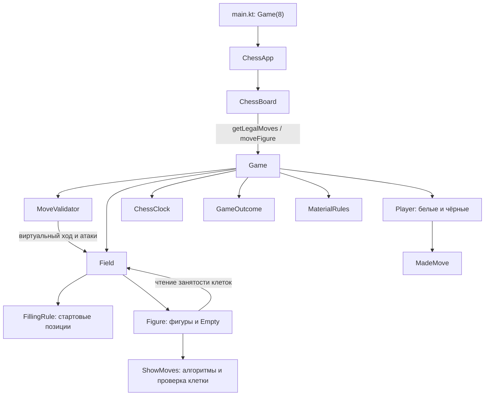

# Игровой движок Moba Chess

Документ описывает фактическую реализацию исходников на 16 октября 2026 года. Его задача — объяснить, где хранится состояние партии, как рассчитываются и применяются ходы и как движок связан с интерфейсом.

Ядро написано на Java в `composeApp/src/jvmMain/java`, интерфейс — на Kotlin с Compose Desktop в `composeApp/src/jvmMain/kotlin/org/chess`. Реализованы расстановка 8×8, легальные ходы и взятия, превращение, рокировка, взятие на проходе, мат, пат, результат партии, основные правила ничьей и часы в модели. Запрос проверяется до изменения шахматного состояния; завершённая партия больше не принимает ходы. Детектор невозможности мата работает по материалу; общий анализ закрытых позиций с пешками выделен в отдельную задачу по согласованию с пользователем.

Добавлены режимы `CLASSIC` и `MOBA`. Разделы 1-11 описывают шахматную основу; особенности составного хода и Пуджа изложены в [разделе 12](#12-moba-прототип-и-пудж-ладья) и [PUDGE_ROOK.md](PUDGE_ROOK.md). В Classic перемещение сразу передаёт очередь; в Moba это делает явная команда `endTurn` после обязательного перемещения.

## Содержание

- [1. Архитектура и исходники](#1-архитектура-и-исходники)
- [2. Координаты и представление доски](#2-координаты-и-представление-доски)
- [3. Создание партии и начальная расстановка](#3-создание-партии-и-начальная-расстановка)
- [4. Модель фигуры и расчёт доступных клеток](#4-модель-фигуры-и-расчёт-доступных-клеток)
- [5. Правила перемещения отдельных фигур](#5-правила-перемещения-отдельных-фигур)
- [6. Применение хода, специальные правила и результат](#6-применение-хода-специальные-правила-и-результат)
- [7. Игроки, очки и история](#7-игроки-очки-и-история)
- [8. Связь с интерфейсом и часами](#8-связь-с-интерфейсом-и-часами)
- [9. Примеры и проверка](#9-примеры-и-проверка)
- [10. Ограничения текущей реализации](#10-ограничения-текущей-реализации)
- [11. Где расширять движок](#11-где-расширять-движок)
- [12. Moba-прототип и Пудж-Ладья](#12-moba-прототип-и-пудж-ладья)

## 1. Архитектура и исходники

| Компонент | Назначение | Исходник |
| --- | --- | --- |
| `Game` | Доска, игроки, очередь, специальные права, история, повторения, результат и часы; последовательное применение команд | [Game.java](../composeApp/src/jvmMain/java/game/core/Game.java) |
| `GameOutcome`, `Termination` | Причина завершения и победитель; `NONE` означает ничью или незавершённую игру | [GameOutcome.java](../composeApp/src/jvmMain/java/game/state/GameOutcome.java), [Termination.java](../composeApp/src/jvmMain/java/game/state/Termination.java) |
| `Promotion`, `MoveKind` | Выбор фигуры при превращении и тип записанного хода | [Promotion.java](../composeApp/src/jvmMain/java/game/moves/Promotion.java), [MoveKind.java](../composeApp/src/jvmMain/java/game/moves/MoveKind.java) |
| `CastlingRights` | Неизменяемые четыре права рокировки | [CastlingRights.java](../composeApp/src/jvmMain/java/game/state/CastlingRights.java) |
| `ChessClock`, `ClockSnapshot` | Расход монотонного времени и неизменяемый снимок часов | [ChessClock.java](../composeApp/src/jvmMain/java/game/core/ChessClock.java), [ClockSnapshot.java](../composeApp/src/jvmMain/java/game/state/ClockSnapshot.java) |
| `MaterialRules` | Проверка невозможности мата по материалу для ничьей, сдачи и тайм-аута | [MaterialRules.java](../composeApp/src/jvmMain/java/rules/standard/MaterialRules.java) |
| `MoveResult` | Успех или конкретная причина отказа; `isSuccess()` и `getMessage()` | [MoveResult.java](../composeApp/src/jvmMain/java/game/moves/MoveResult.java) |
| `AvailableMoves` | Два списка целей: обычные ходы и взятия | [AvailableMoves.java](../composeApp/src/jvmMain/java/game/moves/AvailableMoves.java) |
| `GamePosition` | Согласованный снимок расстановки, очереди и прав; вход для новой партии | [GamePosition.java](../composeApp/src/jvmMain/java/game/state/GamePosition.java) |
| `PositionValidator` | Проверка структуры доски и согласованности состояния | [PositionValidator.java](../composeApp/src/jvmMain/java/rules/standard/PositionValidator.java) |
| `MoveValidator` | Проверка геометрии и безопасности короля на виртуальной доске | [MoveValidator.java](../composeApp/src/jvmMain/java/rules/standard/MoveValidator.java) |
| `Player` | Цвет игрока, взятые фигуры, сделанные ходы и накопленные очки | [Player.java](../composeApp/src/jvmMain/java/game/core/Player.java) |
| `MadeMove` | Имя фигуры, начальная и конечная координаты; строка для истории | [MadeMove.java](../composeApp/src/jvmMain/java/game/history/MadeMove.java) |
| `Field` | Неизменяемый снимок 64 клеток, начальная расстановка, запуск расчёта ходов фигуры | [Field.java](../composeApp/src/jvmMain/java/model/Field.java) |
| `FieldMethods` | Интерфейс с методом `compute(Figure)` | [FieldMethods.java](../composeApp/src/jvmMain/java/model/FieldMethods.java) |
| `Position` | Неизменяемая координата клетки или смещение; сложение и сравнение координат | [Position.java](../composeApp/src/jvmMain/java/model/Position.java) |
| `FigureColor` | Значения `WHITE`, `BLACK`, `NONE` | [FigureColor.java](../composeApp/src/jvmMain/java/model/FigureColor.java) |
| `Figure` | Общие данные и операции фигуры | [Figure.java](../composeApp/src/jvmMain/java/model/Figure.java) |
| `Pawn`, `Knight`, `Bishop`, `Rook`, `Queen`, `King`, `Empty` | Конкретные алгоритмы движения и представление пустой клетки | [model/figures](../composeApp/src/jvmMain/java/model/figures) |
| `ShowMoves` | Контракт расчёта, общая проверка клетки, диагностический вывод | [ShowMoves.java](../composeApp/src/jvmMain/java/rules/standard/ShowMoves.java) |
| `FillingRule` и наследники | Описание стартовых позиций | [FillingRule.java](../composeApp/src/jvmMain/java/rules/field_filling/FillingRule.java), [filling_rules](../composeApp/src/jvmMain/java/rules/field_filling/filling_rules) |
| `TriFunction` | Функция из трёх аргументов для реестра конструкторов фигур | [TriFunction.java](../composeApp/src/jvmMain/java/rules/standard/TriFunction.java) |
| `ChessBoard` | Выбор фигуры, подсветка целей, вызов движка, часы и история на экране | [ChessBoard.kt](../composeApp/src/jvmMain/kotlin/org/chess/ChessBoard.kt) |



`ChessBoard` получает цели через `Game.getLegalMoves`, а результат применения — через `Game.moveFigure`. Java-ядро не зависит от Compose, но фигуры связаны с конкретным объектом `Field`.

## 2. Координаты и представление доски

`Position(row, column)` использует индексы с нуля. Для доски 8×8 допустимый диапазон обоих значений — `0..7`.

| Клетка | Внутренние координаты |
| --- | --- |
| a1 | `Position(0, 0)` |
| e2 | `Position(1, 4)` |
| e4 | `Position(3, 4)` |
| h8 | `Position(7, 7)` |

Белые начинают на строках `0` и `1` и движутся пешками в сторону увеличения `row`. Чёрные начинают на строках `7` и `6` и движутся пешками в сторону уменьшения `row`. Интерфейс выводит строки от `7` до `0`, поэтому белые находятся снизу.

`Position.addPosition(other)` возвращает новый объект с суммой координат. Исходные объекты не изменяются. `equals` и `hashCode` зависят от `row` и `column`, поэтому отдельно созданный `new Position(1, 4)` может найти клетку e2 в карте и в списке целей.

`Field` хранит неизменяемую `Map<Position, Figure>`. Каждая из 64 клеток содержит настоящую фигуру или `Empty` с цветом `NONE`. `getFigureByPosition` возвращает `null` для `null` и координат за пределами доски; внутри доски отсутствующих клеток нет.

`Position` — `final` с неизменяемыми `row` и `column`, без `setRow/setColumn`. Положение, цвет, имя, стоимость и привязка настоящей фигуры к `Field` тоже неизменяемы; `Figure.move/setPosition` удалены. При успешном ходе `Game` публикует новый `Field`. Сохранённая ранее ссылка на поле или фигуру описывает прежнюю позицию и не меняется.

Карта, её ключи, значения и позиции согласованы. Добавление/удаление клетки или замена значения через `getGameField()` вызывают `UnsupportedOperationException`. Для актуальной доски нужно снова вызвать `Game.getGameField()`, а для согласованной расстановки вместе с правами — `Game.getPosition()`.

## 3. Создание партии и начальная расстановка

В [main.kt](../composeApp/src/jvmMain/kotlin/org/chess/main.kt) выполняется `remember { Game(8) }`. Этот экземпляр передаётся в `ChessApp` как исходная игра. В классических вариантах меню `ChessApp` создаёт новую `Game(8, seconds)`, а в вариантах с Пуджем - `Game.mobaPrototype(rules, 600)`, затем передаёт её в `ChessBoard`; после завершения кнопка «Новая партия» возвращает в меню для создания следующей игры.

Конструктор `Game(n)`:

1. Создаёт `Field(n)`.
2. Создаёт `Player(true)` для белых и `Player(false)` для чёрных.
3. Назначает белого игрока текущим.
4. Инициализирует права рокировки, пустую историю, нулевой счётчик тихих полуходов, активный результат и первое вхождение начальной позиции. `Game(n)` работает без часов; `Game(n, seconds)` сразу запускает часы. Конструктор `Game(n, LongSupplier)` позволяет подставить монотонный источник времени для тестов.

Поддерживается только стандартная **8×8**. `Game(n)` и `Field(n)` отклоняют любой другой размер с `IllegalArgumentException` до заполнения. По решению пользователя классы `FillingRule10x10` и `FillingRule16x16` сохранены без изменений для будущего, но не выбираются конструктором. Интерфейс также остаётся 8×8.

В [FillingRule8x8.java](../composeApp/src/jvmMain/java/rules/field_filling/filling_rules/FillingRule8x8.java) заданы две карты `Map<Figure, List<Position>>`: для чёрных и белых. Их ключи — прототипы типа и цвета без позиции и поля, созданные конструктором только с цветом; эти объекты не размещаются на доске.

`Field(8)` сначала создаёт все 64 `Empty`, затем размещает белые и чёрные фигуры по правилу и проверяет полную карту. Реестр `CONSTRUCTORS` содержит шесть настоящих типов и `Empty`; ссылки вида `Pawn::new` хранятся через `TriFunction`. `createFigure(type, position, color)` создаёт отдельный объект, связанный с полем, без изменения доски. Неизвестный тип, выход за 8×8 или неправильный цвет отклоняются с `IllegalArgumentException`.

Стартовая расстановка 8×8 стандартная по расположению фигур:

| Строка | Содержимое от a до h |
| --- | --- |
| 8 (`row = 7`) | Чёрные: ладья, конь, слон, ферзь, король, слон, конь, ладья |
| 7 (`row = 6`) | Восемь чёрных пешек |
| 3–6 (`row = 2..5`) | Пустые клетки |
| 2 (`row = 1`) | Восемь белых пешек |
| 1 (`row = 0`) | Белые: ладья, конь, слон, ферзь, король, слон, конь, ладья |

### Подготовленная позиция и проверка целостности

`Field.fromPosition(Map<Position, Figure>)` копирует и проверяет всю карту, затем создаёт новые фигуры, привязанные к новому полю. Ввод обязан содержать все 64 клетки, включая `Empty`, с совпадающими ключами и координатами фигур. Проверяются известные классы, цвета, ровно один король каждой стороны, несоседство королей, отсутствие пешек на крайних горизонталях, не более 8 пешек и 16 фигур одной стороны. Дополнительные ферзи, ладьи, кони и одноцветные слоны требуют достаточного числа отсутствующих пешек для превращений.

Для полноценного начального состояния используется `Game.fromPosition(GamePosition)`:

- `board` — полная карта; `GamePosition` сразу защищает её копию от внешнего изменения.
- `sideToMove` — `WHITE` или `BLACK`.
- `castlingRights` — явные четыре права; каждое требует своего короля и ладьи на домашних клетках. Отсутствующее право не выводится из расположения автоматически.
- `enPassantTarget` — `null` или пустая цель предыдущего двойного хода: проверяются горизонталь, цвет и положение пешки, пустая исходная клетка, нулевой счётчик и согласованность предыдущей позиции. Наличие соседней пешки для взятия не обязательно.
- `halfmoveClock` — неотрицательное число полуходов без пешечного хода и взятия.

Король стороны, уже сделавшей ход, не может оставаться под шахом. Король текущей стороны может быть под шахом; дальнейшие запросы должны его снять. Ошибки данных вызывают `IllegalArgumentException` с причиной до создания партии и расчёта ходов. Неподдерживаемая фигура не запускает собственные алгоритмы.

Структурная проверка `Field` не проверяет очередь и права: для начала игры следует использовать `Game.fromPosition`, который добавляет эти проверки. Это проверка структуры и согласованности, а не доказательство полной исторической достижимости позиции из стартовой расстановки.

Новая игра из позиции создаётся **без истории, очков, предложений ничьей и часов**, с одним вхождением исходной позиции в повторениях. Мат, пат, недостаточный материал и правило 75 ходов проверяются сразу. `startClock` может включить часы до первого хода. Перегрузка с `LongSupplier` позволяет тестировать время. `GamePosition` не является форматом сохранения всей партии: прежние повторения, результат сдачи или тайм-аута, события и часы не восстанавливаются.

## 4. Модель фигуры и расчёт доступных клеток

`Figure` хранит неизменяемые `position`, `color`, `field`, `name`, `points`, а также вычисляемый массив `moves` и два списка геометрических результатов:

- `canMove` — пустые клетки, на которые фигура может переместиться согласно своему алгоритму.
- `canAttack` — занятые противником клетки, на которых можно выполнить взятие согласно этому алгоритму.

Базовый конструктор только присваивает данные; `fillMoves()` вызывается в конструкторах конкретных `final` классов. Списки результатов изначально пустые, включая `Empty`, и геттеры возвращают неизменяемые копии с неизменяемыми координатами.

Для расчёта геометрических целей вызывают `Field.compute(figure)`. Он выполняет две операции в заданном порядке:

```java
figure.fillMoves();
figure.computeFutureMovesAndAttacks();
```

`fillMoves()` подготавливает направления или абсолютные цели. `computeFutureMovesAndAttacks()` проверяет их по снимку доски, к которому привязана фигура. `Field.compute` выполняет оба вызова под общей блокировкой фигуры и отклоняет объект от другого снимка или прототип без позиции. Кэш содержит производные данные и не может разрешить ход в обход `Game`.

Порядок важен: у пешки и коня массивы содержат абсолютные координаты, зависящие от текущей позиции. Для новой позиции создаётся новая фигура, её цели рассчитываются заново. У слона, ладьи, ферзя и короля `moves` содержит относительные смещения.

Общий метод `ShowMoves.checkMovePosition(color, position, field)`:

1. Проверяет границы доски.
2. Возвращает `false`, если на клетке фигура того же цвета.
3. Возвращает `true` для пустой клетки или фигуры другого цвета.

Этот метод не различает перемещение и взятие, не проверяет шах и предполагает, что внутри границ все клетки присутствуют в карте. Классы фигур сами разделяют допустимые цели по цвету содержимого.

`printMovesAndAttackPositions(...)` выводит расчёт в консоль; текущий интерфейс его не вызывает.

Для интерфейса и других вызывающих слоёв используется **`Game.getLegalMoves(from)`**. Он возвращает `AvailableMoves` с целями только текущего игрока, отфильтрованными по безопасности короля; пустая, чужая или выходящая за границы исходная клетка даёт пустые списки. Прямые результаты `Field.compute` остаются геометрическими кандидатами и сами по себе не доказывают легальность.

`MoveValidator.candidates` создаёт временную фигуру того же типа через `Field.createFigure`, рассчитывает геометрию и добавляет кандидаты рокировки и взятия на проходе из состояния партии. Клетки настоящей доски и кэши исходной фигуры не изменяются. Каждый кандидат проходит проверку короля. Для цели превращения проверка наличия легального хода использует вариант ферзя; фактическая фигура выбирается в запросе. `AvailableMoves` содержит неизменяемые списки с неизменяемыми `Position`. `moveFigure` независимо проверяет полученный запрос заново.

## 5. Правила перемещения отдельных фигур

| Класс | Геометрия движения | `name` в текущем коде | `points` |
| --- | --- | --- | --- |
| `Pawn` | Вперёд на 1 или 2 строки; взятие по диагонали на 1 строку | `Pawn` | 1 |
| `Knight` | Восемь целей со смещениями `(±2, ±1)` и `(±1, ±2)` | `Knight` | 3 |
| `Bishop` | Четыре диагональных направления | `Bishop` | 5 |
| `Rook` | Четыре горизонтальных и вертикальных направления | `Rook` | 3 |
| `Queen` | Восемь горизонтальных, вертикальных и диагональных направлений | `Queen` | 9 |
| `King` | На одну клетку в восьми направлениях | `King` | 10 |
| `Empty` | Расчёта нет | `Empty` | 0 |

Стоимость — именно значения из исходников, а не стандартная шахматная оценка материала. Имя и стоимость задаются при создании как размещённых фигур, так и прототипов расстановки.

### Слон, ладья и ферзь

Для каждого направления алгоритм пошагово прибавляет смещение к позиции:

- На пустой клетке добавляет координату в `canMove` и продолжает луч.
- На фигуре противника добавляет координату в `canAttack` и завершает луч.
- На своей фигуре или за границей завершает луч без добавления цели.

Таким образом, эти фигуры не проходят сквозь занятые клетки. Реализация обхода лучей повторяется в трёх классах.

### Конь и король

Конь проверяет восемь конечных клеток независимо: промежуточные клетки не учитываются. Король проверяет восемь соседних клеток. В обоих случаях пустые цели попадают в `canMove`, противники — в `canAttack`, свои фигуры и выход за границу исключаются.

Геометрический расчёт самого `King` ещё не проверяет атаки противника. `Game.getLegalMoves` и `moveFigure` дополнительно исключают ход под шах, соседство с вражеским королём и взятие короля.

### Пешка

В [Pawn.java](../composeApp/src/jvmMain/java/model/figures/Pawn.java) `factor = 1` для белых и `-1` для чёрных. От текущей позиции формируются:

- Ходы: `(factor, 0)` и `(2 * factor, 0)`.
- Атаки: `(factor, 1)` и `(factor, -1)`.

В список ходов добавляются только пустые цели. В список атак — только клетки с противником; пустые диагонали не считаются атаками в этом API. Поэтому `canAttack` нельзя использовать как универсальную карту всех атакованных клеток для проверки безопасности короля.

Двойной ход доступен только со стартовой строки: `row = 1` для белых и `row = field.getSize() - 2` для чёрных. Обе клетки впереди должны быть пустыми. Любая фигура на первой клетке останавливает расчёт обоих ходов, независимо от цвета. Отдельного флага первого хода нет: для обычной игры без возврата пешки назад стартовая строка достаточна.

Взятие вперёд запрещено. Превращение и взятие на проходе обрабатываются на уровне партии, потому что зависят от выбора игрока или предыдущего хода; низкоуровневый `Pawn.computeFutureMovesAndAttacks` сам их не добавляет.

### Пустая клетка

`Empty` наследует `Figure`, но оба метода расчёта пустые. Его списки целей всегда пустые. Интерфейс не выбирает `Empty` как собственную фигуру, поскольку её цвет — `NONE`.

## 6. Применение хода, специальные правила и результат

Основные перегрузки:

```java
MoveResult moveFigure(Player player, Position from, Position to);
MoveResult moveFigure(Player player, Position from, Position to, Promotion promotion);
```

При отказе не меняются доска, позиции и кэши фигур, очередь, очки, взятые фигуры, история, права рокировки, цель взятия на проходе и счётчик тихих полуходов. **Часы продолжают учитывать прошедшее время**, в том числе после неправильного запроса или во время выбора фигуры для превращения. Истечение времени может завершить партию при обработке запроса.

Обработка запроса:

1. Обновляет часы; завершённая партия возвращает `GAME_OVER`.
2. Проверяет текущего игрока и копирует координаты запроса.
3. Валидирует границы, источник, цвет, цель, геометрию, препятствия, специальный ход и безопасность своего короля.
4. Повторно проверяет время непосредственно перед применением: если срок истёк во время проверки, ход не выполняется.
5. Подготавливает новую полную карту с перемещением, взятием и дополнительными изменениями специального хода; проверяет и создаёт новый `Field`, затем публикует его.
6. Начисляет очки за взятие, обновляет права рокировки, цель на проходе и счётчик тихих полуходов.
7. В Classic переключает текущего игрока и часы, учитывает новую позицию в повторениях. В Moba расходует лимит обычного перемещения и оставляет очередь/часы у того же игрока до `endTurn`.
8. В Classic проверяет мат, пат и автоматические ничьи после перемещения; в Moba мат/пат проверяются на границе передачи очереди с учётом доступных способностей. При завершении часы останавливаются.
9. Создаёт одно событие `MadeMove`, добавляет его в общую историю и историю игрока и возвращает `SUCCESS`.

Команды партии и чтение связанных данных синхронизированы на `Game`. Два одновременных запроса одного игрока не применяются как два последовательных хода этой стороны. Возвращаемые карта и положение фигур защищены от внешнего изменения. `getPosition()` читает узкий позиционный DTO для классической позиции, а `getSnapshot()` - всё текущее состояние, включая ID фигур, героев и составной ход. Для Moba использовать `GameSnapshot`: `GamePosition` не передаёт бюджет и героев, а права на проходе между действиями предназначены следующему игроку. Набор отдельных геттеров между командами может относиться к разным моментам.

### Проверка короля без изменения настоящей доски

Валидатор создаёт поверхностную копию карты. Удаляет источник, помещает фигуру на цель, при взятии на проходе удаляет пешку с её настоящей клетки, при рокировке перемещает также ладью. Атаки определяются по **ключам виртуальной карты**, поэтому позиции настоящих объектов не приходится менять и откатывать.

Пешки атакуют диагонали, включая пустые; кони проверяют прыжки; короли — соседние клетки; слоны, ладьи и ферзи — лучи до препятствия. Связанные фигуры противника также учитываются как атакующие клетки для безопасности короля. Собственного короля должно быть ровно один. Эта проверка не является полным валидатором произвольно повреждённой позиции.

### Обычное перемещение и взятие

При ходе на пустую клетку её объект `Empty` переносится на исходную клетку. При обычном взятии на источнике создаётся новый `Empty`. Взятая фигура удаляется из карты заменой значения и добавляется в список игрока; её стоимость начисляется один раз.

### Превращение

`Promotion` разрешает `QUEEN`, `ROOK`, `BISHOP`, `KNIGHT`. Если пешка достигнет последней горизонтали и выбор не передан, возвращается `PROMOTION_REQUIRED` без применения хода. Выбор на обычном ходе отклоняется как `INVALID_PROMOTION`.

После выбора пешка заменяется новой фигурой своего цвета. Превращение со взятием, запись события, начисление очков, переключение очереди и обновление результата выполняются как один ход. В истории сохраняются исходное имя `Pawn` и выбранное превращение. В интерфейсе выбор открывается в диалоге; отмена диалога оставляет позицию прежней.

### Рокировка

`CastlingRights` хранит четыре права: короткая и длинная рокировка белых и чёрных. Ход короля снимает оба права его цвета; ход ладьи со стартовой клетки или её взятие на этой клетке снимает соответствующее право. Возвращение ладьи или короля назад и появление новой ладьи не восстанавливают право.

Для стандартной доски 8×8 короткая рокировка — `e1 → g1` / `e8 → g8`, ладья `h → f`; длинная — `e → c`, ладья `a → d`. Нужна ладья того же цвета на исходной клетке. Клетки между королём и ладьёй должны быть пустыми, включая b-файл при длинной рокировке. Запрещено рокировать из шаха, через атакованную клетку и в шах. Атака на саму ладью или b-клетку при длинной рокировке не запрещает рокировку, если путь короля безопасен.

В общей истории появляется один `MadeMove` с `MoveKind.CASTLING`; текст содержит `[O-O]` или `[O-O-O]`.

### Взятие на проходе

После двойного хода пешки `enPassantTarget` указывает на пройденную клетку. Только следующий успешный ход противника может использовать это право; любой другой успешный ход очищает или заменяет цель. Отклонённый запрос право не расходует.

Пешка перемещается на пустую диагональную цель, а соседняя пешка противника удаляется со своей клетки. Виртуальная проверка короля учитывает освобождение **обеих исходных клеток**. В истории сохраняются `MoveKind.EN_PASSANT`, имя взятой фигуры и фактическая клетка взятия.

### Результаты команд

`MoveResult` содержит `isSuccess()` и русское `getMessage()`. Основные причины отказа:

| Результат | Значение |
| --- | --- |
| `GAME_OVER` | Партия завершена, включая истечение времени |
| `WRONG_PLAYER` | Не тот игрок или объект другого участника |
| `OUT_OF_BOUNDS`, `SAME_SQUARE` | Некорректные координаты |
| `EMPTY_SOURCE`, `WRONG_FIGURE_COLOR` | Нет своей фигуры на источнике |
| `OWN_PIECE_AT_TARGET`, `KING_CAPTURE_NOT_ALLOWED` | Запрещённая цель взятия |
| `ILLEGAL_MOVEMENT`, `KING_IN_CHECK` | Неверное перемещение или небезопасный король |
| `PROMOTION_REQUIRED`, `INVALID_PROMOTION` | Требуется выбор превращения либо он неуместен |
| `INVALID_BOARD` | Обнаружено нарушение необходимых данных позиции |
| `INVALID_DRAW_CLAIM` | Нет условий для заявления ничьей |
| `NO_DRAW_OFFER`, `DRAW_OFFER_PENDING` | Нет предложения соперника либо предложение уже ожидает ответа |
| `DRAW_AGREEMENT_TOO_EARLY` | Одна из сторон ещё не сделала своего первого хода |

Если нарушено несколько условий, возвращается первое обнаруженное нарушение. `MoveResult` используется также для сдачи и действий с ничьей; `SUCCESS` означает, что команда выполнена, а не обязательно что фигура перемещена.

### Завершение партии

`Game.getOutcome()` возвращает неизменяемый `GameOutcome`: `getReason()`, `getWinner()`, `isFinished()` и `getMessage()`. Причины перечислены в `Termination`. Для активной игры причина — `IN_PROGRESS`, победитель — `NONE`. Для ничьей победитель также `NONE`, но `isFinished()` возвращает `true`.

После успешного хода:

- Нет легальных ходов и король под атакой: `CHECKMATE`, победил соперник.
- Нет легальных ходов и шаха нет: `STALEMATE`, ничья.
- Мат исключён по материалу у обеих сторон: `INSUFFICIENT_MATERIAL`.
- Достигнуты условия автоматической ничьей: соответствующая причина повторения или счётчика ходов.

Мат имеет приоритет над правилом 75 ходов. Завершение очищает предложение ничьей и останавливает часы. Ходы, сдача и действия с ничьей после завершения не меняют результат; легальные цели становятся пустыми.

### Ничьи, сдача и соглашение

Правила повторения, счётчика ходов и результата при истечении времени сверены с [правилами FIDE](https://handbook.fide.com/chapter/e012023). Реализован следующий набор:

| Условие | Действие |
| --- | --- |
| Третье вхождение позиции | Ничья по заявлению текущего игрока |
| Пятое вхождение позиции | Автоматическая ничья |
| 100 полуходов без пешечного хода и взятия | Ничья по заявлению |
| 150 таких полуходов | Автоматическая ничья; мат приоритетнее |

Ключ повторения включает расстановку типов и цветов, очередь, права рокировки и цель на проходе **только при наличии легального взятия**. Время и счётчик тихих полуходов в ключ не входят. Пешечный ход и любое взятие сбрасывают этот счётчик в ноль.

`canClaimDraw(player)` и `claimDraw(player)` проверяют уже достигнутое условие. Перегрузка `claimDraw(player, from, to, promotion)` проверяет объявленный легальный ход, который создаст условие, и при успехе завершает партию **без выполнения объявленного хода**. Есть соответствующий запрос `canClaimDrawAfterMove`. Интерфейс позволяет заявить ничью по текущей позиции или выбрать фигуру, включить заявление и указать цель.

`offerDraw(player)` сохраняет предложение; `acceptDraw(opponent)` завершает игру по соглашению, `declineDraw(opponent)` снимает предложение. Принять можно только предложение соперника, когда обе стороны сделали хотя бы один ход. Предложение сохраняется через ход предложившего и отклоняется при успешном ходе получателя.

`resign(player)` завершает игру с победой соперника. Если мат со стороны соперника исключён детектором материала, фиксируется ничья с отдельной причиной `RESIGNATION_DRAW`.

### Принятый объём проверки невозможности мата

`MaterialRules` проверяет материал и цвета клеток слонов. Распознаются голые короли, один конь или слон против голого короля, а также случаи с одноцветными слонами без материала, который допускает мат. Два коня не объявляются автоматически недостаточным материалом: возможность мата и возможность его форсировать различаются.

Для тайм-аута и сдачи оценивается материал именно потенциального победителя с учётом фигур соперника, способных помочь создать матовую позицию. Метод `canPossiblyMate` возвращает `false`, когда мат исключён проверкой материала; `true` означает, что эта проверка его не исключила.

По согласованию с пользователем общий анализ редких закрытых или вынужденно мёртвых позиций, где невозможность мата зависит от расположения и цепочки ходов, выделен в TODO-38. Это ограничение относится и к соответствующим решениям при тайм-ауте и сдаче.

## 7. Игроки, очки и история

`Player` хранит цвет, список взятых фигур, историю и сумму их стоимости. `getPoints()` возвращает сумму. Начисление очков и добавление событий доступны внутри пакета `game` и вызываются `Game` после успешной проверки. `getMadeMoves()` и `getAttackedFigures()` возвращают неизменяемые снимки, которые не растут после следующих ходов. Идентификаторов пользователей и транспорта в этом классе нет.

`Game.getMoves()` возвращает список общих событий в порядке полуходов, защищённый от добавления и удаления. Каждое событие также помещается в список сделавшего ход игрока. `MadeMove` хранит:

- Имя исходной фигуры, её цвет и копии координат источника и цели.
- `MoveKind`: обычный ход, взятие, рокировка, взятие на проходе или превращение.
- Выбор `Promotion`, имя взятой фигуры и фактическую клетку взятия, если они есть.
- Номер общего полухода `ply` и неизменяемый `ClockSnapshot` на момент его завершения.

Геттеры координат события возвращают копии неизменяемых `Position`; запись защищена от изменений через входные и выходные ссылки. Обычная строка остаётся вида `Pawn: (2, e) -> (4, e)`; специальные ходы получают поясняющий суффикс. Это собственный формат, поддержка SAN, PGN и FEN пока отсутствует.

`getLastMoveAsString()` берёт последнее общее событие и до первого хода возвращает пустую строку. После отказа последним остаётся предыдущий успешный ход. Для результата команды нужно использовать `MoveResult`.

Для точного отката пока недостаёт снимков дополнительных прав до и после события. Полное сохранение/загрузка реализованы через `GameSaveFile` и `Game.fromSnapshot`; отмена и пошаговое воспроизведение остаются отдельными задачами.

## 8. Связь с интерфейсом и часами

[ChessApp.kt](../composeApp/src/jvmMain/kotlin/org/chess/ChessApp.kt) переключает меню и игру. Выбор 180, 360 или 600 секунд создаёт свежую `Game(8, seconds)` с уже запущенными часами. `key(activeGame)` отделяет Compose-состояние разных партий.

[ChessBoard.kt](../composeApp/src/jvmMain/kotlin/org/chess/ChessBoard.kt) выбирает собственную фигуру, получает цели через `getLegalMoves`, передаёт запрос движку и показывает причину отказа. При `PROMOTION_REQUIRED` появляется выбор четырёх фигур. При завершении показываются результат и кнопка «Новая партия». Для активной игры доступны сдача, предложение/принятие/отклонение ничьей и её заявление.

История строится непосредственно из `Game.getMoves()` и фильтруется по цвету для [MoveHistoryColumn.kt](../composeApp/src/jvmMain/kotlin/org/chess/MoveHistoryColumn.kt). Отдельные накапливаемые списки строк в Compose удалены; пересоздание экрана не стирает историю игры.

### Часы в модели

`ChessClock` принадлежит `Game`. По умолчанию источник — `System.nanoTime`; тесты подставляют `LongSupplier`. Остатки хранятся в наносекундах, поэтому смена игрока и частота отображения не теряют доли секунды.

`startClock(seconds)` вызывается один раз до ходов; время должно быть положительным. Повторная настройка, настройка после хода или завершения отклоняется исключением. `Game(n)` позволяет играть без часов.

`getClockSnapshot()` обновляет расход времени и возвращает неизменяемые остатки обеих сторон, признак включения/работы и активный цвет. Снимки доступны вне Compose и включены в события ходов. Монотонная временная точка внутри часов не предназначена для переноса между процессами; `Game.fromSnapshot` восстанавливает остатки и создаёт новую временную точку без начисления времени вне загруженной игры.

Перед командой и непосредственно перед применением хода движок проверяет время. При нуле фиксируется `TIMEOUT` с победой соперника либо `TIMEOUT_DRAW`, если его мат исключён детектором материала. Отсутствие отрисовки или опроса интерфейса не позволяет выполнить просроченный ход. Завершённая партия имеет остановленные часы и неизменяемый результат.

Compose опрашивает снимок приблизительно каждые 100 мс и не вычитает секунды самостоятельно. Закрытие диалога превращения и ошибки запросов время не возвращают. Повторное создание экрана читает остатки из той же игры.

### Оставшиеся ограничения отображения

`ChessBoard` опрашивает единый `GameSnapshot` примерно каждые 100 мс и обновляет его после локальной команды. Внешние вызовы API также появляются в UI при очередном опросе. Выбор хранится по ID фигуры, поэтому после перемещения того же Пуджа остаются доступны его способности. Свою фигуру можно сменить одним кликом; при выборе способности приоритет имеют её допустимые цели. `Empty` отображает точку обычного перемещения, a1 окрашена тёмной. Интерфейс остаётся 8×8.

В просмотренных исходниках и зависимостях этой папки WebSocket-транспорт не найден. Его расположение нужно уточнить отдельно; данная документация описывает локальное ядро.

## 9. Примеры и проверка

Обычный ход и обработка результата:

```java
Game game = new Game(8, 600); // 10 минут каждой стороне; часы сразу запущены.
Position from = new Position(1, 4); // e2
Position to = new Position(3, 4);   // e4
MoveResult result = game.moveFigure(game.getCurrentPlayer(), from, to);
if (result.isSuccess()) {
    System.out.println(game.getLastMoveAsString());
} else {
    System.out.println(result.getMessage());
}
System.out.println(game.getOutcome().getMessage());
ClockSnapshot time = game.getClockSnapshot();
```

На готовой позиции превращение передаётся отдельным аргументом:

```java
MoveResult result = game.moveFigure(game.getCurrentPlayer(), from, to, Promotion.KNIGHT);
```

Нельзя передавать превращение для обычного хода. Предварительный вызов `getLegalMoves` нужен для подсветки, но не обязателен для отправки запроса.

Получить согласованную позицию и начать из неё новую партию:

```java
GamePosition snapshot = game.getPosition();
Game otherGame = Game.fromPosition(snapshot); // Без старой истории и часов.
Field oldBoard = game.getGameField();
game.moveFigure(game.getCurrentPlayer(), from, to);
// oldBoard по-прежнему описывает состояние до хода.
Field currentBoard = game.getGameField();
```

Чтобы подготовить собственную позицию, создают отдельную карту всех 64 клеток. Фигуры можно получить через `Field.createFigure`, пустые клетки — через `Empty.class` с цветом `NONE`. Затем передают `new GamePosition(board, turn, rights, ep, halfmoveClock)` в `Game.fromPosition`; редактора существующей партии через карту нет.

Проверка на Windows с JDK 21 или новее:

```powershell
.\gradlew.bat :composeApp:jvmTest
```

Набор содержит 370 тест:

| Набор | Что проверяет |
| --- | --- |
| [GameTest.java](../composeApp/src/jvmTest/java/game/core/GameTest.java) | Базовые ходы, взятия, безопасность короля, ошибки запроса и сохранение состояния |
| [SpecialMovesTest.java](../composeApp/src/jvmTest/java/game/core/SpecialMovesTest.java) | Оба цвета и варианты специальных ходов, потерю прав и виртуальные проверки короля |
| [TerminationTest.java](../composeApp/src/jvmTest/java/game/core/TerminationTest.java) | Мат, пат, материал, заявления/автоматику ничьей, сдачу, соглашение и конкурентные команды |
| [ClockTest.java](../composeApp/src/jvmTest/java/game/core/ClockTest.java) | Наносекундный расход времени, смену сторон, редкий опрос, тайм-ауты, выбор превращения и остановку часов |
| [ApiIntegrityTest.java](../composeApp/src/jvmTest/java/game/core/ApiIntegrityTest.java) | Защиту коллекций и координат, сохранённые снимки, неверные позиции, очередь, материал, права, загрузку специальных и завершённых позиций |
| [MobaGameTest.java](../composeApp/src/jvmTest/java/game/core/MobaGameTest.java) | ID, составной ход, хук, проглатывание, реакции, специальные права, заряды, часы и конкурентные команды |
| [MobaUiTest.kt](../composeApp/src/jvmTest/kotlin/org/chess/MobaUiTest.kt) | Реальный сценарий через Compose без видимого окна: выбор Пуджа, ульта, перемещение, завершение |

| [PudgeScenarioTest.java](../composeApp/src/jvmTest/java/game/scenarios/PudgeScenarioTest.java) | Все пять подсказок, заряд за два взятия, восемь соседей, независимость ульты от КД хука и чистый перезапуск |
| [PudgeScenariosUiTest.kt](../composeApp/src/jvmTest/kotlin/org/chess/PudgeScenariosUiTest.kt) | Отрисовка сценариев, выбор в меню, кнопки перезапуска до завершения хода и возврата |

| [GameSaveFileTest.java](../composeApp/src/jvmTest/java/game/persistence/GameSaveFileTest.java) | Полное восстановление, бюджеты, пассажиры/реакции, шах, права, часы, ошибки файла и повреждённые связи |
| [GameSaveUiTest.kt](../composeApp/src/jvmTest/kotlin/org/chess/GameSaveUiTest.kt) | Загрузка из меню, сохранение через приложение, отмена и отказ при повреждённом файле |

В тестах времени используется управляемый источник без ожидания реальных секунд. При отказах специальных ходов дополнительно сравниваются права, цель на проходе, счётчики, ключ повторения, общая история, результат, предложение ничьей и часы при неизменном тестовом времени.

## 10. Ограничения текущей реализации

| Область | Открытая задача |
| --- | --- |
| Сложные мёртвые позиции | Общий анализ закрытых позиций с пешками и вынужденных цепочек; текущая проверка ограничена материалом |
| Размеры | Только 8×8 по решению пользователя; 10×10 и 16×16 отложены, заглушки сохранены, другой размер явно отклоняется |
| Достижимость позиции | `PositionValidator` проверяет структуру и согласованность; полного исторического анализа цепочки ходов нет |
| Восстановление | Полные сохранения XML 1–7 реализованы; точная отмена, полный replay и стандартные шахматные форматы остаются отдельными задачами |
| Moba-контент | Шесть выбираемых героев, копирование способностей, призываемая Баба-яга, болото, базовое золото и локальный драфт; предметы, нейтрал и особые правила превращения ещё не реализованы |

Открытые пункты и уже выполненные изменения перечислены в [TODO.md](TODO.md).

## 11. Где расширять движок

- **Новая фигура:** наследник `Figure`, алгоритмы геометрии, имя и стоимость, регистрация в `Field`, ограничения `PositionValidator`, описание атак в `MoveValidator`, проверка влияния на `MaterialRules`, расстановка и `CellView`.
- **Новые правила:** состояние прав/счётчиков, геометрические кандидаты, виртуальные изменения, фактическое применение и запись события; обязательно сохранять неизменность шахматного состояния при отказе.
- **Новая расстановка:** заполнение всех клеток и проверка позиции; размеры и стартовые права должны соответствовать выбранным правилам.
- **Сохранение/отмена:** состояние специальных прав и счётчиков до и после хода, результат и снимок часов с восстановлением на новую монотонную временную точку.
- **Другой интерфейс или транспорт:** вызовы команд `Game`, проверка `MoveResult`, чтение результата/часов и доставка изменений в представление; полученные поля и фигуры являются снимками; для новых состояний использовать команды `Game` и проверяемый `Game.fromPosition`.

При изменении реализации обновлять этот документ и ToDo вместе с кодом.


## 12. Moba-прототип и Пудж-Ладья

### ID, состояние и снимки

`PieceState` хранит постоянный ID, тип, цвет, положение/статус, `HeroType`, КД, заряд ульты, три `ItemSlot` и ID проглоченного союзника. Статусы - `BOARD`, `SWALLOWED`, `CAPTURED`. ID сохраняется при пересоздании `Field`, обычном перемещении, рокировке, превращении, проглатывании и возврате. Пустые клетки ID не получают. Сами объекты состояния и коллекции неизменяемы.

`GameSnapshot` под общей блокировкой читает поле, все состояния фигур, `TurnState`, очередь, права, счётчики/повторения, часы, результат, обычную историю, события, очки/взятия и предложение ничьей. Версия меняется при применённой команде и завершении. Расход времени отражается новым `ClockSnapshot`; каждое обновление времени не является новой игровой командой. Полная сериализация/восстановление текущего состояния реализованы через `GameSaveFile` и `Game.fromSnapshot`.

### Команды и ход

`TurnState` показывает номер хода игрока и два использованных лимита: `moveUsed` и `abilityUsed`. `moveFigure` в Moba не передаёт очередь. `useAbility(player, actorPosition, targetPosition, Ability)` расходует один общий лимит хука/ульты. `endTurn(player)` требует успешного обычного перемещения, затем передаёт очередь, переключает часы, сбрасывает лимиты и уменьшает КД новой активной стороны.

`useItem(player, pieceId, slot)` не зависит от лимитов перемещения/способности, но каталог предметов пока пуст. Команда проверяет сторону, наличие фигуры и слот 0-2; пустой слот не меняет бюджет.

Если обычное перемещение ещё не выполнено, способность допустима только при наличии хотя бы одного легального обычного перемещения после её эффекта. Иначе возвращается `NO_MOVE_AFTER_ABILITY`, а цель не подсвечивается: это предотвращает ход, который невозможно завершить. После уже выполненного перемещения эта дополнительная проверка не нужна.

`getAbilityTargets` и `getAbilityAvailability` позволяют показать допустимые цели и причины недоступности. Скилл и перемещение одной фигурой разрешены, порядок свободный. Эффект перемещения, вызванный скиллом, не выполняет обязательное обычное перемещение.

### Проверка действия до публикации

`ActionEngine` готовит новый `Field`, копию состояний и список взятий. Обычная геометрия проверяется через `MoveValidator`; для Moba дополнительно разрешаются ответные взятия Пуджа и проверяется итоговый шах своему королю. Реакции, ID, права и ресурсы публикуются вместе. Отказ не расходует лимит, КД или заряд; реальные часы продолжают идти.

В Moba структурный валидатор сохраняет 64 клетки, классы/цвета, оба короля и допустимое число фигур, но допускает пешку на крайних горизонталях вследствие принудительного перемещения и не выводит состав из числа недостающих обычных пешек. В Classic ограничения прежние.

### Первый герой и границы прототипа

`HeroType.PUDGE_ROOK` назначается ладьям a1/a8 в меню. Хук тянет по восьми лучам радиуса 3 до соседней клетки; ульта хранит союзника радиуса 1 и выпускает его с ответным взятием при гибели Пуджа. В обычном режиме ульта требует два взятия самим героем, включает все восемь соседних клеток и не имеет отдельного КД. Хук пока использует временный КД 2 собственных хода. Конкретные условия и инструкция описаны в [PUDGE_ROOK.md](PUDGE_ROOK.md).

В Moba мат/пат проверяются с учётом возможной способности перед обязательным перемещением. Классические автоматические ничьи по материалу, повторениям и 50/75 ходам здесь не применяются; сдача/тайм-аут завершаются победой соперника, ничья по соглашению поддержана. В Classic сохраняется прежний набор правил. Золото новых Moba-партий учитывается отдельно; предметы пока не добавлены. Загрузка всей текущей Moba-партии реализована.


### Тестовые позиции и сохранение

`PudgeScenario` создаёт независимые Moba-партии из фиксированных позиций. Они не используют часы; четыре позиции снимают требование заряда, пятая проверяет порог 2. `PudgeScenariosMenu` выбирает позицию, а `ChessApp` хранит выбранный сценарий и создаёт новую `Game` при перезапуске. Новый экземпляр оборачивается в `key(activeGame)`, поэтому выделение и диалоги не переносятся. Инструкции: [TEST_SCENARIOS.md](TEST_SCENARIOS.md).

Сохранение и загрузка Classic/Moba-партий реализованы через версионированный XML. Кнопки доступны внизу правой панели; загрузка также есть в главном меню. Подробности и API: [SAVE_STATE.md](SAVE_STATE.md).


### Полное восстановление партии

`Game.fromSnapshot(GameSnapshot[, LongSupplier])` проверяет снимок и создаёт отдельную партию с новыми объектами игроков и часов. ID, истории, взятия/очки, результат, предложения ничьей, повторения и бюджет текущего хода сохраняются. Это отличается от `fromPosition`, который начинает новую партию без накопленного состояния.

`SnapshotValidator` проверяет доску и ID, однозначность и отсутствие циклов содержимого Пуджа, бюджеты против событий, очки против взятий, часы и результат. Для Moba учитывается снимок посреди хода: чужой король может уже получить косвенный шах; метаданные взятия на проходе учитывают уже сделанное перемещение до передачи очереди.

`GameSaveFile` записывает XML версии 1 через временный файл рядом с назначением. До замены данные подготовлены и проверены. При поддержке файловой системы используется атомарная замена. Чтение ограничено 16 МиБ, DTD и внешние сущности отключены, неизвестные типы/версии отклоняются. Ошибка загрузки не заменяет текущую игру.


## 13. Структура исходников

Пакет `game` разделён по ответственности; карта классов и правила расширения находятся в [PROJECT_STRUCTURE.md](PROJECT_STRUCTURE.md). `ActionEngine` и изменяемые части игрока/часов остаются внутри `game.core`. Хук, проглатывание, заряд и ответные взятия выделены в `game.heroes.pudge.PudgeAbilities`. `HeroAbilities` выбирает реализацию по герою, а `HeroEffect` передаёт неизменяемое предложение изменений. Ядро проверяет итоговую доску и только затем публикует действие.

Проверены четыре XML-сохранения, созданные движком до переноса пакетов: бюджет и часы посреди хода, содержимое Пуджа и реакция, заряд ульты, косвенный шах и классические права. Формат XML версии 1 сохраняется. Наборы [LegacySaveCompatibilityTest.java](../composeApp/src/jvmTest/java/game/persistence/LegacySaveCompatibilityTest.java) и [PudgeAbilitiesTest.java](../composeApp/src/jvmTest/java/game/heroes/pudge/PudgeAbilitiesTest.java) также проверяют продолжение игры и закрытость изменяемого API.


## 14. Lumeshard и временные эффекты

`HeroRules` содержит независимые `PudgeRules`, `LumeshardRules`, `BountyCrowRules`, `BolotnikRules` и `GoldRules`. Новые `HeroType.LUMESHARD_BISHOP`, `Ability.LASER` и `Ability.TELEPORT` подключены в `HeroAbilities`; реализация находится в `game.heroes.lumeshard`. Фабрики и снимки используют `HeroRules`, прежние перегрузки с `PudgeRules` и `getPudgeRules()` сохранены.

`PieceState.blindTurns` сопровождает любую фигуру, а `startingColor` обязателен для Lumeshard. Операции размещения/проглатывания сохраняют эти данные. Истечение ослепления выполняется при `endTurn` его владельца, включая проглоченные фигуры; КД обновляется при начале своего хода.

`rules.moba.AttackRules` формирует позиции ослеплённых атакующих, не удаляя их с доски. Перегрузка `MoveValidator.validate` учитывает этот набор при проверке короля и транзитных клеток рокировки; Classic использует пустой набор. `ActionEngine` отдельно запрещает обычные взятия ослеплённой фигурой, включая взятие на проходе, и проверяет конечную доску с актуальными состояниями эффектов.

Телепорт допускает пустую цель и передаёт её координату реализации героя. Он не выставляет `moveUsed`. Подсветка и валидация используют тот же путь подготовки результата. `SnapshotValidator` учитывает эффекты при проверке шаха и бюджета. `GameSaveFile` поддерживает XML 1/2/3/4: исходный цвет, ослепление и конфигурация Lumeshard записываются в версии 2; сохранения без расширения сохраняют прежний формат.

Проверки: [LumeshardTest.java](../composeApp/src/jvmTest/java/game/heroes/lumeshard/LumeshardTest.java), [LumeshardSaveTest.java](../composeApp/src/jvmTest/java/game/persistence/LumeshardSaveTest.java), [LumeshardUiTest.kt](../composeApp/src/jvmTest/kotlin/org/chess/LumeshardUiTest.kt). Описание для игры: [LUMESHARD.md](LUMESHARD.md).


## 15. Bounty Crow и золото

`HeroType.BOUNTY_CROW_PAWN` назначается пешкам b2/b7. После обычного превращения сохраняются ID и способности. `BOUNTY` помечает вражескую фигуру в любой точке доски. `STEAL` применяется без выбора клетки: `useAbility(player, actorSquare, null, Ability.STEAL)`. Полные правила: [BOUNTY_CROW.md](BOUNTY_CROW.md).

`ActionEngine.Context` включает неизменяемые `EconomyState` и номер хода. Начисления и передача золота готовятся на копии вместе с доской; `Game.publish` публикует результат после всех проверок. Подготовленные `Capture` охватывают обычное взятие, проход и реакции Пуджа. Каждое взятие оплачивается один раз соответствующей `creditedSide`; пассивка зависит от `actorId` Crow. Проглатывание и хук не являются оплачиваемыми взятиями.

`GoldRules` задаёт цены PDF. `EconomyState` хранит кошельки, метки и финансовую историю. Деньги представлены целыми половинками золота; `GoldChange` разделяет базовую награду, бонус метки и пассивку. Кража переводит до четырёх половинок со счёта соперника. `Player.getPoints()` остаётся прежним счётчиком очков взятий.

`BountyMark` привязан к ID цели. При стандартных двух следующих собственных ходах `expiresAfterTurn` равен номеру хода наложения +4. Метка действует до конца этого хода включительно. `endTurn` удаляет истёкшие метки; взятие снимает метку немедленно. Смерть источника её не снимает, повторное применение обновляет срок без сложения бонуса.

Новые Moba-партии начинают с нулевых кошельков. XML 3 сохраняет экономику; `EconomyValidator` сверяет суммы с финансовой историей, взятия с событиями, бонусы со сроками метки и кражу с доступным балансом. Версии 1/2 читаются в прежнем режиме без экономики. Classic не включает золото. Нейтральные фигуры остаются этапом M06.

Добавлены три учебные позиции Crow, кошельки рядом с часами, отметка +1,5 и кнопка кражи без выбора клетки. Проверки: `BountyCrowTest`, `BountyCrowSaveTest`, `BountyCrowUiTest`.


## 16. Bolotnik и клетки болота

Добавлен `HeroType.BOLOTNIK_KNIGHT`, по умолчанию g1/g8. `MUD` нацеливается на пустую или союзную клетку радиуса 4, включая клетку самого героя. `AMBUSH` применяется без цели: `useAbility(player, actor, null, Ability.AMBUSH)`. Цели-короли и короли в области ульты запрещены. Правила: [BOLOTNIK.md](BOLOTNIK.md).

`TerrainState` хранит неизменяемую карту `Position → MudCell`, отдельно от фигур. Клетка содержит владельца, `MUD`/`AMBUSH` и срок; для бессрочной ульты срок 0. `PieceState.Status.HIDDEN_BOG` допускается только для Bolotnik и требует полной области его ульты в карте. ID, КД, заряд, слоты и эффекты скрытого героя сохраняются.

`TerrainResolver` готовит размещение и реакции на копии состояний. Для ульты область сортируется по столбцу A–H: враг, уже стоящий на самой левой клетке, запускает единственное мгновенное взятие. Иначе герой остаётся скрытым. Изменения позиции обычным ходом, хуком, телепортом и выпуском из Пуджа проверяются на вход в ловушку. Срабатывание перемещает исходного героя, учитывает заряд и `Capture.Cause.BOG`, затем реакцию взятого Пуджа; золото начисляется по полному списку фактических взятий. Гибель владельца удаляет его оставшееся болото.

`TerrainGeometry` проверяет промежуточные клетки, включая две клетки по длинной стороне прыжка коня. `MoveValidator` получил перегрузки с препятствиями для перемещающейся стороны и отдельно для атакующего соперника; прежние Classic-перегрузки используют пустые множества. Moba выполняет финальную проверку своего короля после всех реакций; рокировка сохраняет проверки исходной и проходной клеток. Свои фигуры и атаки игнорируют своё болото.

`ActionEngine.canEnd` учитывает исчезновение временного болота при завершении. Поиск доступного хода проверяет возможность завершить его, в том числе способность после обычного перемещения. Поэтому исчезающая защита не позволяет принять заведомо незавершаемый ход, но разрешает восстановить защиту доступным скиллом после перемещения. Мат/пат и проверка снимка используют этот же поиск.

`BOG_CAPTURE` отделён от `COUNTER_CAPTURE` Пуджа. Запись обычного перемещения не приписывает игроку взятие его собственной фигуры, погибшей в ловушке. Ульта с мгновенным взятием записывает событие способности и отдельное событие взятия. Кошелёк, заряд, права, проход и история публикуются вместе. XML 4 содержит `bolotnikRules`, `terrain` и скрытый статус; чтение 1/2/3 сохранено.

UI рисует болото под фигурами, показывает скрытого героя и четыре учебные позиции. Проверки: `BolotnikTest`, `BolotnikSaveTest`, `BolotnikUiTest`.

## Пики и баны

В обычном Moba-режиме `ChessApp` сначала открывает `DraftScreen`. Независимая модель `game.draft.Draft` проверяет очередь, глобальные баны, уникальность героя и совместимость выбранной стартовой клетки. При завершении выбора `Game.mobaFromDraft` повторно проверяет журнал, создаёт стандартную доску, назначает только выбранных героев и запускает часы. Остальные фигуры остаются обычными.

`GameSnapshot.draft` хранит неизменяемый исходный состав отдельно от текущего состояния фигур. `DraftValidator` вызывается при восстановлении полного снимка; XML 5 включает правила и действия завершённого драфта. Старые партии без драфта сохраняют прежние версии. Правила, схема API и ограничения: [DRAFT.md](DRAFT.md).

Проверки драфта: `DraftTest`, `DraftGameTest`, `DraftSaveTest`, `DraftUiTest`. Они покрывают отказы без изменения состояния, уникальность, раннее завершение, размещение, часы, цвет Lumeshard, исходный состав после взятия, повреждённые сохранения и полный выбор кнопками Compose.

## Изба, создание фигур и срок жизни

Изба — ладья с пассивным призывом после взятия и ультой `SUMMON_YAGA` без цели за два собственных взятия. Баба-яга — пешка только через призыв; по сроку превращается в Избу с сохранением ID и нулевым зарядом. Правила: [IZBA.md](IZBA.md).

`SummonState` включён в `GameSnapshot` и контекст `ActionEngine`. `SummonResolver` создаёт новые ID, выбирает клетку на копии генератора и обрабатывает пассивки после цепочек взятий. Новая фигура проходит проверку входа в болото. `Game.endTurn` превращает созревшие фигуры перед передачей очереди и оценкой результата. `REPLACED` отделяет удаление от взятия; Пудж и его содержимое при замене не запускают реакции или награды.

`SummonValidator` проверяет происхождение, формы, сроки и события. `DraftValidator` сверяет исходных героев, исключая призванные ID. Moba допускает добавочные фигуры; шахматные лимиты Classic сохраняются. XML 6 хранит генератор и журнал призыва, старые драфты воспроизводятся с версией каталога 1. Тесты: `IzbaTest`, `IzbaSaveTest`, `IzbaUiTest`.

## Ginseng, сдвиг и история активных способностей

Добавлен шестой выбираемый герой — слон [Ginseng](GINSENG.md). `AbilityRequest` расширяет команду отдельной клеткой назначения и признаком применения копии. Сдвиг выбирает фигуру в радиусе 3 и свободного соседа цели; копирование берёт последнее успешное активное применение выбранного героя по ID. Старый API применения способностей сохранён.

`SpellState` содержит последние применения и по одной одноразовой копии. `ActionEngine` готовит память вместе с эффектами и публикует её только после проверки безопасности и допустимого продолжения. Копия готова со следующего собственного хода, расходуется лишь при успехе и участвует в общем лимите способности. Поиск мата/пата и подсветка учитывают сдвиг с двумя целями и доступные копии.

`BorrowedEffects` использует реализации исходных героев с нулевыми дополнительными затратами; реальный Ginseng сохраняет тип слона, ID, свой КД/заряд, инвентарь и стартовый цвет. Постоянные последствия работают через общие слои: содержимое и реакция Пуджа, `TerrainState`, `EconomyState`, `SummonState`. Пассивки не копируются. XML 7 воспроизводит `SpellState` по событиям с `borrowed`/`copiedAbility`; каталог драфта 3 добавляет Ginseng, сохраняя прежние каталоги 1/2.

Проверки: `GinsengTest`, `GinsengSaveTest`, `GinsengUiTest`, расширенный `DraftGameTest`; полный набор — **370 тест**. Правила и примеры команд: [GINSENG.md](GINSENG.md).
